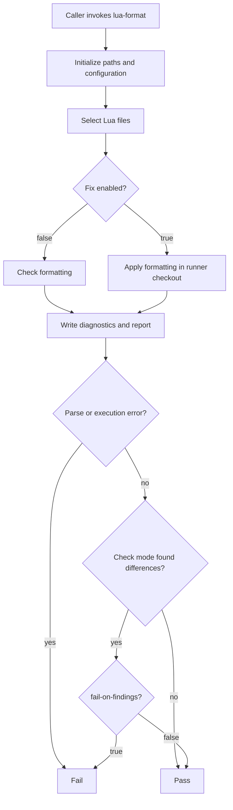

# Lua Format Pipeline <!-- omit in toc -->

The `lua-format` workflow is the reusable formatting pipeline for Lua source files. It runs StyLua using repository-specific configuration and supports both formatting checks and formatting fixes.

The workflow can be called directly or through the [`validate-lua`](../validate-lua/) orchestration pipeline. A consuming repository supplies scan paths, optional exclusions, configuration, formatting mode, findings policy, and report artifact settings.

The workflow separates formatting differences from errors:

- Check mode reports files that need formatting.
- Fix mode applies formatting in the runner's checkout.
- Formatting differences can remain advisory or fail validation in check mode.
- Parse errors and execution failures remain blocking.

## Table of Contents <!-- omit in toc -->

- [Formatting modes](#formatting-modes)
- [Inputs](#inputs)
  - [Source selection](#source-selection)
  - [Formatting behavior](#formatting-behavior)
  - [Reports and artifacts](#reports-and-artifacts)
  - [Template selection](#template-selection)
- [Permissions and secrets](#permissions-and-secrets)
- [Configuration](#configuration)
- [Fix behavior](#fix-behavior)
- [Result handling](#result-handling)
- [Formatting flow](#formatting-flow)
- [Example consuming repository pipeline stub](#example-consuming-repository-pipeline-stub)
- [PR validation integration](#pr-validation-integration)

## Formatting modes

| Mode  | Input        | Behavior                                                   |
| ----- | ------------ | ---------------------------------------------------------- |
| Check | `fix: false` | Report formatting differences without requesting fixes.    |
| Fix   | `fix: true`  | Apply formatting changes in the runner's working checkout. |

Check mode is appropriate for automatic PR validation. Fix mode is appropriate when a caller intentionally requests formatting changes and has a defined way to recover or publish those changes.

## Inputs

### Source selection

- `paths`: Paths included in Lua file selection. Use `"."` to scan the repository scope.
- `exclude-paths`: Optional paths excluded from Lua file selection.

### Formatting behavior

- `settings-file`: StyLua configuration file in the consuming repository.
- `fail-on-findings`: Whether formatting differences fail validation in check mode.
- `fix`: Apply formatting changes instead of only checking formatting.

For advisory checks:

```yaml
fix: false
fail-on-findings: false
```

For blocking checks:

```yaml
fix: false
fail-on-findings: true
```

For formatting fixes:

```yaml
fix: true
```

### Reports and artifacts

- `artifact-name`: Name of the uploaded formatting report artifact.
- `artifact-retention-days`: Number of days to retain the artifact.

A report artifact is not necessarily a source-code artifact. Do not assume it contains formatted files or an applicable patch unless the workflow explicitly publishes them.

### Template selection

`templates-ref` selects the PipelineTemplates branch, tag, or commit used to obtain shared supporting files. The reference in `uses:` selects the reusable workflow definition. `templates-ref` selects the supporting PipelineTemplates revision.

Keep both references aligned unless intentionally testing different revisions.

## Permissions and secrets

```yaml
permissions:
  contents: read
```

## Configuration

Pass the consuming repository's StyLua configuration explicitly:

```yaml
settings-file: ".stylua.toml"
```

If the repository uses `stylua.toml`, select that file instead:

```yaml
settings-file: "stylua.toml"
```

The configuration file defines formatting rules. Workflow inputs determine the scan scope, execution mode, and failure policy.

## Fix behavior

Enable fix mode with:

```yaml
fix: true
```

> [!WARNING]
> Fix mode changes files in the runner's working checkout.

## Result handling

In check mode:

| Result                    | `fail-on-findings: false` | `fail-on-findings: true` |
| ------------------------- | ------------------------- | ------------------------ |
| Files already formatted   | Pass                      | Pass                     |
| Formatting differences    | Pass with diagnostics     | Fail                     |
| Parse errors              | Fail                      | Fail                     |
| Tool or execution failure | Fail                      | Fail                     |

Disabling failure on findings makes formatting differences advisory. It does not suppress diagnostics or ignore errors. In fix mode, review the run's diagnostics to determine whether formatting completed successfully.

## Formatting flow



## Example consuming repository pipeline stub

The following manual caller exposes check/fix mode and formatting failure policy:

```yaml
---
name: Lua format

on:
  workflow_dispatch:
    inputs:
      fix:
        description: "Apply formatting changes with StyLua."
        required: false
        type: boolean
        default: false

      fail-on-findings:
        description: "Fail on formatting differences in check mode."
        required: false
        type: boolean
        default: false

permissions:
  contents: read

jobs:
  format:
    uses: redjax/pipelinetemplates/.github/workflows/lua-format.yml@main
    with:
      templates-ref: "main"

      paths: "."
      settings-file: ".stylua.toml"

      fix: ${{ inputs.fix }}
      fail-on-findings: ${{ inputs['fail-on-findings'] }}

      artifact-name: "manual-lua-format-results"
      artifact-retention-days: 7
```

The defaults in this caller select advisory check mode.

## PR validation integration

Use check mode for automatic PR validation:

```yaml
format: true
fix: false
```

When calling [`validate-lua`](../validate-lua/), configure formatting findings through:

```yaml
format-fail-on-findings: false
```

Set the input to `true` when formatting differences should block the final PR gate. The `use-cache` input on `validate-lua` belongs to Luacheck. It does not control StyLua.
