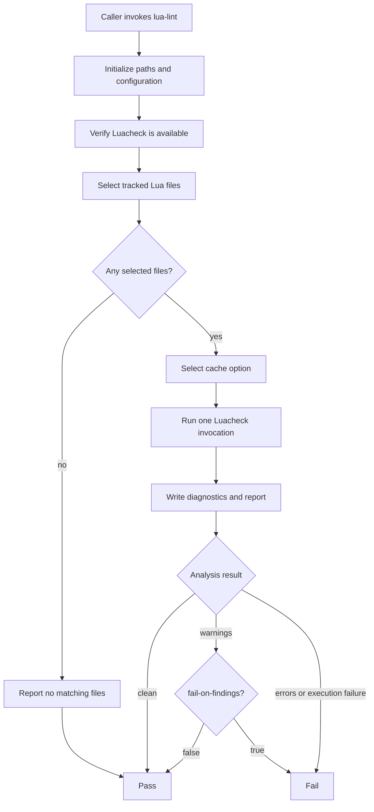

# Lua Lint Pipeline <!-- omit in toc -->

The `lua-lint` workflow is the reusable linting pipeline for Lua source files. It runs Luacheck using repository-specific configuration, publishes diagnostics, and lets consuming repositories decide whether lint warnings should fail validation.

The workflow can be called directly or through the [`validate-lua`](../validate-lua/) orchestration pipeline. A consuming repository supplies scan paths, optional exclusions, configuration, cache behavior, findings policy, and report artifact settings.

Lint warnings and lint errors are handled separately:

- Warnings can remain advisory or fail validation.
- Errors and execution failures remain blocking.
- Disabling failure on findings does not suppress diagnostics.

## Table of Contents <!-- omit in toc -->

- [Responsibilities](#responsibilities)
- [Inputs](#inputs)
  - [Source selection](#source-selection)
  - [Lint behavior](#lint-behavior)
  - [Reports and artifacts](#reports-and-artifacts)
  - [Template selection](#template-selection)
- [Permissions and secrets](#permissions-and-secrets)
- [Configuration](#configuration)
- [Cache behavior](#cache-behavior)
- [Result handling](#result-handling)
- [Lint flow](#lint-flow)
- [Example consuming repository pipeline stub](#example-consuming-repository-pipeline-stub)
- [PR validation integration](#pr-validation-integration)

## Responsibilities

- Select matching tracked Lua files from the consuming repository.
- Apply caller-provided path exclusions.
- Resolve the Luacheck configuration.
- Run the selected files through one Luacheck invocation.
- Enable or disable Luacheck caching.
- Write diagnostics to the job log and lint report.
- Publish the lint report as a workflow artifact.
- Apply the caller's warning failure policy without ignoring errors.

## Inputs

### Source selection

- `paths`: Paths included in Lua file selection. Use `"."` to scan the repository scope.
- `exclude-paths`: Optional paths excluded from Lua file selection.

File selection is based on tracked files. An untracked local file is not part of the selected input set. When no matching tracked Lua files are selected, the lint script reports that analysis was skipped and exits successfully.

### Lint behavior

- `settings-file`: Luacheck configuration file in the consuming repository.
- `use-cache`: Enable or disable Luacheck's analysis cache.
- `fail-on-findings`: Whether Luacheck warnings fail the workflow.

Use the consuming repository's `.luacheckrc` with:

```yaml
settings-file: ".luacheckrc"
```

Keep warnings advisory with:

```yaml
fail-on-findings: false
```

Require warning-free lint results with:

```yaml
fail-on-findings: true
```

Errors and execution failures remain blocking in either configuration.

### Reports and artifacts

- `artifact-name`: Name of the uploaded lint report artifact.
- `artifact-retention-days`: Number of days to retain the artifact.

### Template selection

- `templates-ref`: PipelineTemplates repository branch, tag, or commit used to obtain shared supporting files. The reference in `uses:` selects the reusable workflow definition. `templates-ref` selects the supporting PipelineTemplates revision. Keep both references aligned unless intentionally testing different revisions.

## Permissions and secrets

The consuming examples use:

```yaml
permissions:
  contents: read
```

No custom secret is passed for ordinary linting of the calling repository. Linting does not need to commit changes or push to the source branch.

## Configuration

The lint script initializes its shared quality settings using:

```text
Template configuration: config/lua/.luacheckrc
Repository configuration name: .luacheckrc
```

A consuming repository can select its configuration explicitly:

```yaml
settings-file: ".luacheckrc"
```

Luacheck receives the resolved configuration path through `--config`. The invocation also disables default configuration discovery with `--no-default-config`, keeping configuration selection explicit.

## Cache behavior

The workflow exposes Luacheck caching through `use-cache`:

```yaml
use-cache: true
```

The setting is forwarded to the lint script as `USE_CACHE`.

| Setting  | Script environment | Luacheck option |
| -------- | ------------------ | --------------- |
| Enabled  | `USE_CACHE=true`   | `--cache`       |
| Disabled | `USE_CACHE=false`  | `--no-cache`    |

The script defaults an unset `USE_CACHE` to `false` and rejects values other than `true` or `false`.

Enabling caching and preserving caching are separate operations:

- `use-cache` controls whether Luacheck uses its analysis cache.
- Restoring and saving cache data between workflow runs requires separate cache persistence handling.

## Result handling

The lint script normalizes its result to these exit codes:

| Script exit code | Meaning                                           |
| ---------------- | ------------------------------------------------- |
| `0`              | Clean analysis or no matching selected files.     |
| `1`              | Luacheck reported warnings.                       |
| `2`              | Luacheck reported errors or an execution failure. |

The workflow applies `fail-on-findings` to the warnings result:

| Result                    | `fail-on-findings: false` | `fail-on-findings: true` |
| ------------------------- | ------------------------- | ------------------------ |
| Clean analysis            | Pass                      | Pass                     |
| No matching files         | Pass                      | Pass                     |
| Lint warnings             | Pass with diagnostics     | Fail                     |
| Lint errors               | Fail                      | Fail                     |
| Tool or execution failure | Fail                      | Fail                     |

The combined lint invocation reports the overall result. It does not use the earlier per-file warning and error counters. The lint report includes the selected configuration, selected-file count, diagnostics, and overall result.

## Lint flow



## Example consuming repository pipeline stub

The following manual caller runs linting without running formatting:

```yaml
---
name: Lua lint

on:
  workflow_dispatch:
    inputs:
      use-cache:
        description: "Enable Luacheck's analysis cache."
        required: false
        type: boolean
        default: false

      fail-on-findings:
        description: "Fail validation on lint warnings."
        required: false
        type: boolean
        default: false

permissions:
  contents: read

jobs:
  lint:
    uses: redjax/pipelinetemplates/.github/workflows/lua-lint.yml@main
    with:
      templates-ref: "main"

      paths: "."
      settings-file: ".luacheckrc"

      use-cache: ${{ inputs['use-cache'] }}
      fail-on-findings: ${{ inputs['fail-on-findings'] }}

      artifact-name: "manual-lua-lint-results"
      artifact-retention-days: 7
```

## PR validation integration

Use [`validate-lua`](../validate-lua/) when a PR-validation workflow should coordinate both linting and formatting.

For advisory lint warnings:

```yaml
lint: true
lint-fail-on-findings: false
```

The PR workflow should evaluate the reusable workflow result in its final gate. A manual lint run is independent of automatic PR validation and should not be a prerequisite that someone must launch before the PR gate can finish.
