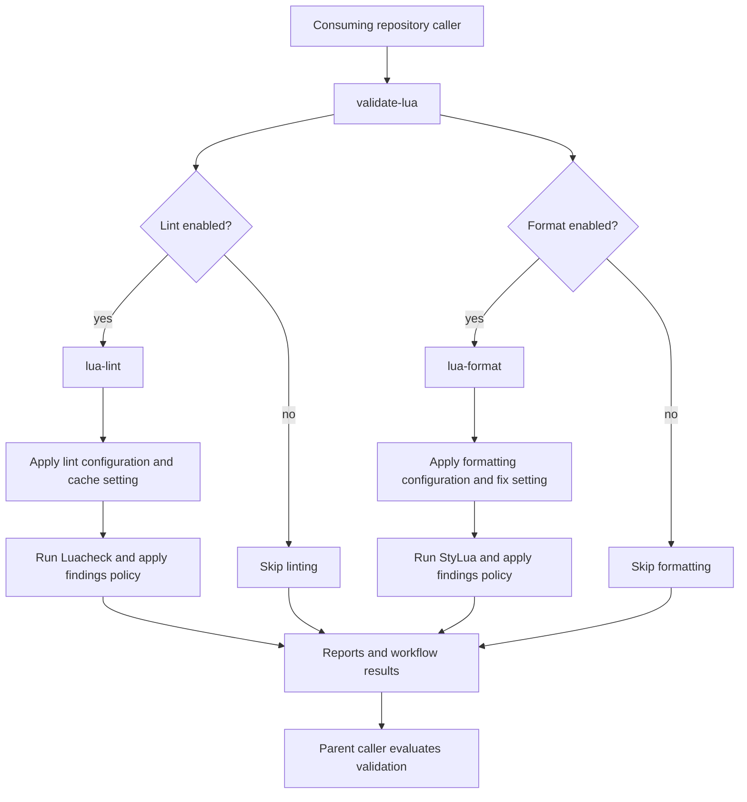

# Validate Lua Pipeline <!-- omit in toc -->

The `validate-lua` workflow is the reusable orchestration pipeline for Lua quality checks.

It coordinates these shared workflows:

- [`lua-lint`](../lua-lint/)
- [`lua-format`](../lua-format/)

A consuming repository calls this workflow from a thin workflow stub and supplies source paths, configuration files, enabled checks, findings policies, cache behavior, and report artifact settings.

The pipeline supports independently selected operations:

- Lint-only runs execute Luacheck.
- Format-only runs execute StyLua.
- Combined runs enable both workflows.
- Manual callers can expose linting, formatting, lint caching, and formatting fixes as selectable inputs.

The central reusable workflow and the consuming repository's manual workflow serve different purposes:

| Workflow                     | Trigger             | Responsibility                                              |
| ---------------------------- | ------------------- | ----------------------------------------------------------- |
| Central `validate-lua.yml`   | `workflow_call`     | Coordinate reusable Lua checks.                             |
| Consuming `validate-lua.yml` | `workflow_dispatch` | Expose manual controls and forward inputs.                  |
| Consuming `pr-checks.yml`    | `pull_request`      | Launch automatic PR validation and evaluate the final gate. |

## Table of Contents <!-- omit in toc -->

- [Validation modes](#validation-modes)
- [Inputs](#inputs)
  - [Source selection](#source-selection)
  - [Enabled checks](#enabled-checks)
  - [Lint behavior](#lint-behavior)
  - [Formatting behavior](#formatting-behavior)
  - [Reports and artifacts](#reports-and-artifacts)
  - [Template selection](#template-selection)
- [Permissions and secrets](#permissions-and-secrets)
- [Findings and failure behavior](#findings-and-failure-behavior)
- [Cache and fix behavior](#cache-and-fix-behavior)
- [Validation flow](#validation-flow)
- [Example consuming repository pipeline stub](#example-consuming-repository-pipeline-stub)

## Validation modes

| `lint`  | `format` | Behavior                 |
| ------- | -------- | ------------------------ |
| `true`  | `false`  | Run linting only.        |
| `false` | `true`   | Run formatting only.     |
| `true`  | `true`   | Enable both workflows.   |
| `false` | `false`  | No validation requested. |

The manual caller shown below skips the coordinator call entirely when both operations are disabled.

## Inputs

### Source selection

- `paths`: Paths included in Lua file selection. Use `"."` to scan the repository scope.
- `exclude-paths`: Optional paths excluded from file selection.

The same selection settings are supplied to the enabled checks.

### Enabled checks

- `lint`: Enable the [`lua-lint`](../lua-lint/) workflow.
- `format`: Enable the [`lua-format`](../lua-format/) workflow.

These inputs control whether a tool runs. They do not control whether its findings are blocking.

### Lint behavior

- `lint-settings-file`: Luacheck configuration file in the consuming repository.
- `lint-fail-on-findings`: Whether lint warnings fail validation.
- `use-cache`: Enable Luacheck's analysis cache.

For advisory lint warnings:

```yaml
lint: true
lint-settings-file: ".luacheckrc"
lint-fail-on-findings: false
```

The coordinator forwards these inputs to `lua-lint`, using its `settings-file`, `fail-on-findings`, and `use-cache` inputs.

### Formatting behavior

- `format-settings-file`: StyLua configuration file in the consuming repository.
- `format-fail-on-findings`: Whether formatting differences fail validation in check mode.
- `fix`: Apply formatting changes in the runner's checkout.

For advisory formatting checks:

```yaml
format: true
format-settings-file: ".stylua.toml"
format-fail-on-findings: false
fix: false
```

The coordinator forwards the configuration and findings policy to `lua-format`, using its `settings-file` and `fail-on-findings` inputs.

### Reports and artifacts

- `lint-artifact-name`: Lint report artifact name.
- `format-artifact-name`: Formatting report artifact name.
- `artifact-retention-days`: Report artifact retention period.

Keep artifact names distinct when both tools run:

```yaml
lint-artifact-name: "repository-lua-lint-results"
format-artifact-name: "repository-lua-format-results"
artifact-retention-days: 7
```

### Template selection

`templates-ref` selects the PipelineTemplates branch, tag, or commit used to obtain shared supporting files. Keep the reusable-workflow reference and `templates-ref` aligned unless intentionally testing different revisions.

## Permissions and secrets

The manual caller example uses:

```yaml
permissions:
  contents: read
```

## Findings and failure behavior

Lint and formatting policies are independent:

| Category                                       | Controlling input         |
| ---------------------------------------------- | ------------------------- |
| Lint warnings                                  | `lint-fail-on-findings`   |
| Formatting differences in check mode           | `format-fail-on-findings` |
| Lint errors and execution failures             | Always blocking           |
| Formatting parse errors and execution failures | Always blocking           |

For advisory findings:

```yaml
lint-fail-on-findings: false
format-fail-on-findings: false
```

For strict validation:

```yaml
lint-fail-on-findings: true
format-fail-on-findings: true
fix: false
```

Advisory findings remain visible in diagnostics and reports. Enabling advisory mode is not equivalent to ignoring all failures.

## Cache and fix behavior

The two controls affect different tools:

| Input       | Tool     | Scope                                         |
| ----------- | -------- | --------------------------------------------- |
| `use-cache` | Luacheck | Enable or disable analysis caching.           |
| `fix`       | StyLua   | Check formatting or apply formatting changes. |

- `use-cache` has no effect when linting is disabled.
- `fix` has no effect when formatting is disabled.
- Enabling Luacheck caching does not automatically preserve cache data between hosted workflow runs. Cross-run reuse requires cache restore/save handling.
- Enabling formatting fixes does not automatically commit or push modified files. Recovering or publishing those changes requires explicit workflow support.

## Validation flow



## Example consuming repository pipeline stub

The following caller provides a manual workflow with four controls:

- Enable or disable linting.
- Enable or disable formatting.
- Enable or disable lint caching.
- Enable or disable formatting fixes.

```yaml
---
name: Validate Lua

on:
  workflow_dispatch:
    inputs:
      lint:
        description: "Run Luacheck."
        required: false
        type: boolean
        default: true

      format:
        description: "Run StyLua."
        required: false
        type: boolean
        default: true

      use-cache:
        description: "Enable Luacheck's analysis cache."
        required: false
        type: boolean
        default: false

      fix:
        description: "Apply formatting fixes with StyLua."
        required: false
        type: boolean
        default: false

permissions:
  contents: read

jobs:
  validate-lua:
    name: Validate Lua

    if: ${{ inputs.lint || inputs.format }}

    uses: redjax/pipelinetemplates/.github/workflows/validate-lua.yml@main
    with:
      templates-ref: "main"

      paths: "."

      lint: ${{ inputs.lint }}
      format: ${{ inputs.format }}

      lint-settings-file: ".luacheckrc"
      format-settings-file: ".stylua.toml"

      use-cache: ${{ inputs['use-cache'] }}
      fix: ${{ inputs.fix }}

      lint-fail-on-findings: false
      format-fail-on-findings: false

      lint-artifact-name: "manual-lua-lint-results"
      format-artifact-name: "manual-lua-format-results"
      artifact-retention-days: 7
```

The defaults in this consuming stub enable both tools, disable lint caching, and select formatting check mode. The findings policies are fixed to advisory mode in this example. They can also be exposed as manual inputs if the repository needs per-run control.

Replace `main` in both locations with the intended release branch, tag, or commit when adopting the workflow.
